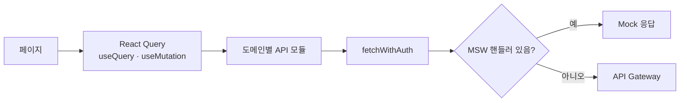
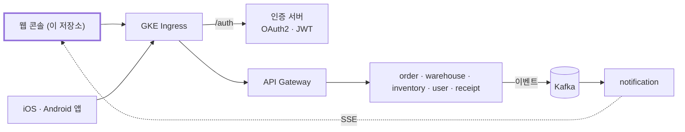

# GearFirst Frontend

자동차 부품 공급망 ERP **GearFirst**의 본사용 웹 콘솔입니다. 대리점 발주 승인부터 품목·BOM·입출고·인사 관리까지 본사 업무를 하나의 화면에서 처리합니다.

> 백엔드 서버가 종료되어, 공개 배포본은 **MSW mock + 인증 bypass**로 동작하는 데모입니다.
> 조회뿐 아니라 등록·수정·삭제·승인도 동작하며, 새로고침하면 초기 데이터로 돌아갑니다.

<br>

## 실행 방법

**요구 사항**: Node.js 20 이상, npm

```bash
npm ci
npm run dev
```

브라우저에서 `http://localhost:5173`으로 접속합니다.

개발 서버에서는 MSW가 항상 켜지고, 저장소의 `.env` 기본값이 인증 bypass라서 백엔드와 인증 서버 없이 바로 모든 화면을 확인할 수 있습니다.

<br>

## 스크립트

| 명령어 | 설명 |
| --- | --- |
| `npm run dev` | 개발 서버 실행 (MSW 사용) |
| `npm run build` | 타입 검사 후 프로덕션 빌드 |
| `npm run preview` | 빌드 결과물 실행 |
| `npm run lint` | ESLint 검사 |
| `npm run test` | Vitest watch 모드 |
| `npm run test:run` | 테스트 1회 실행과 커버리지 리포트 |

<br>

## 구조

### 화면에서 API까지



- API 요청은 `fetchWithAuth`를 거쳐 토큰이 붙고, 401 응답을 받으면 토큰을 재발급해 한 번 재시도합니다. 토큰 발급·재발급 같은 인증 흐름과 공개 회원가입만 예외입니다.
- 등록·수정·삭제 후에는 `invalidateDomain`이 바뀐 데이터를 보여 주는 다른 도메인의 쿼리까지 함께 무효화합니다.

### 전체 서비스 구성



웹 콘솔은 Vercel, 백엔드는 GKE에 배포한 MSA 구조입니다. 서비스마다 DB를 따로 두고, 서비스 사이의 이벤트는 Kafka로 전달해 본사 화면에 알림으로 표시합니다.

### 폴더 구조와 도메인

도메인 단위로 폴더를 나누고, 각 폴더 안에 화면, API, 타입을 함께 둡니다.

```txt
src/
├── auth/            로그인(OAuth2 + PKCE), 토큰 재발급, 사용자 정보
├── routes/          라우팅, 로그인·조직 권한 가드
├── dashboard/       요청, 재고, 입출고 현황 요약
├── request/         대리점·창고 발주 요청 승인과 반려
├── purchasing/      공급업체 견적 비교, 구매 발주
├── items/           부품, 자재, 카테고리 관리
├── bom/             부품별 BOM 구성
├── carModel/        차종 등록, 부품과 차종 매핑
├── part/            창고별 재고, 안전 재고
├── property/        자산 현황
├── inbound/         입고 예정·완료 내역, 검수 상세
├── outbound/        출고 요청과 진행 상태
├── human/           사용자 등록, 수정, 삭제
├── user/            내 정보
├── notification/    알림 목록, SSE 연결
├── components/      공통 UI 컴포넌트
├── hooks/           공통 훅
├── utils/           쿼리 무효화 규칙, JWT 파싱 등 유틸
├── mocks/           MSW 핸들러(조회, 등록·수정·삭제)와 목데이터
└── test/            테스트 설정
```

<br>

## 기술 스택

- **Framework**: React 19, React Router 7, Vite 7, TypeScript 5.8
- **Server State**: TanStack Query 5
- **Styling · UI**: styled-components 6, Recharts, react-datepicker, lucide-react
- **Mocking · Test**: MSW 2, Vitest 4, Testing Library
- **CI · Deploy**: GitHub Actions, Vercel

<br>

## 환경 변수

저장소에 포함된 `.env` 기본값입니다.

```env
VITE_API_BASE_URL=http://localhost:8080
VITE_AUTH_SERVER=http://localhost:8080/auth
VITE_CLIENT_ID=gearfirst-client
VITE_REDIRECT_URI=http://localhost:5173/auth/callback
VITE_USE_MOCK=false
VITE_AUTH_BYPASS=true
```

- **`VITE_USE_MOCK`**: `npm run build`로 만든 빌드본에서 MSW를 켤지 정합니다. 개발 서버(`npm run dev`)에서는 이 값과 관계없이 항상 켜집니다. 배포 데모는 `true`로 빌드합니다.
- **`VITE_AUTH_BYPASS`**: `true`면 인증 서버 없이 데모 계정으로 로그인합니다. 실제 인증 서버와 연동할 때는 `false`로 바꿉니다.

Vite는 환경 변수를 빌드할 때 코드에 넣기 때문에, 빌드본은 값을 바꾼 뒤 다시 빌드해야 반영됩니다.
